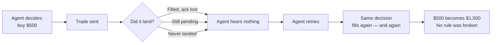
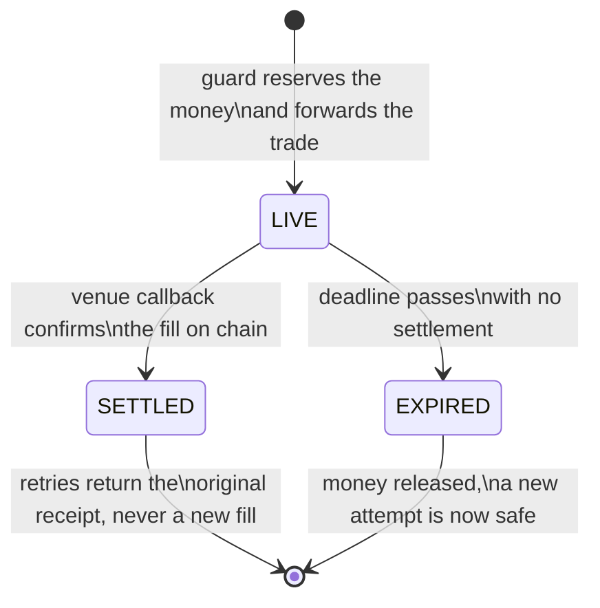
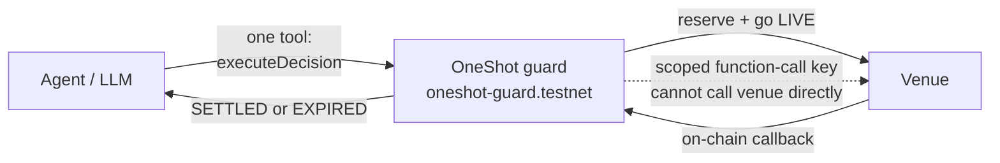

# OneShot — One decision. One shot.

> **The fear this project exists to kill:** "The risk I worry about more sits between the decision and the confirmed trade. Say an agent makes a sound, compliant trade within budget, and the transaction gets delayed or outbid on the way to the block. If the agent can't tell whether it went through, it tries again. Then again. Every retry was individually approved, and together they can do real damage."
>
> — Robin Nordnes, Founder & CEO at Raiku

[](https://explorer.testnet.near.org/accounts/oneshot-guard.testnet)
[](#verification)
[](#tracks)

Built for **NEAR HACKATHON** · Primary track: **AI Security & Defense** · Secondary track: **Unstoppable DeFi** · Live on NEAR testnet.

---

## 1. Start here: the fear

That is the fear Robin Nordnes put into words. Here is what it looks like
in practice.

Picture this, because it is the whole project in one scene.

You hand an AI agent a simple job and a simple budget: *buy $500 of this asset, don't exceed the budget, don't do anything reckless.* The agent does exactly that. It picks a sound trade, inside budget, inside the rules you set, and it sends it.

Then: silence.

The trade was delayed on its way to the block. Or it was outbid. Or the confirmation was dropped on the way back. The agent cannot tell which one happened, because from where it stands, all three look identical: nothing came back.

So the agent does the only sensible thing a program knows how to do when it thinks something failed. It tries again.

Each retry, on its own, passes every check. It is in budget. It follows the rules. It was individually approved. But if the first trade actually went through quietly, and the second and third go through as well, you have not bought $500 of the asset. You have bought it three times. You meant to spend $500. You spent $1,500, and doubled the position you wanted — with no single trade ever breaking a rule.

That is the fear. Not a bad agent. Not a bad decision. A good decision, repeated by a system that could not prove what had already happened.

OneShot exists so an agent never has to guess from silence again.



## 2. The problem, stated precisely

Execution is ambiguous. Between a decision and its confirmed settlement, there is a gap where a trade can be delayed, outbid, or confirmed-but-unacknowledged. In that gap:

- A **timeout is not proof.** "I waited and heard nothing" cannot distinguish *executed-but-silent* from *provably-dead*.
- A **retry limit is not proof either.** Even one retry leaves the agent blind about the first attempt — and a limit counts attempts, it does not prove outcomes.
- **Per-transaction checks cannot catch this.** Every retry passes the budget check on its own. The damage only appears when you add the retries together.

So the failure is not at the level of a transaction. It is at the level of a decision. Fixing it needs a decision-level guarantee, enforced somewhere the agent cannot talk its way around: on chain.

## 3. The answer: a decision with a life story

OneShot gives every decision an identity and a lifecycle, enforced by a NEAR smart contract called the guard. The agent never trades straight to the venue. It trades through the guard, and the guard remembers.

### 3.1 One identity, however many attempts

A decision's identity is a hash of what the decision *is* — the agent, the asset, the size, the direction, the price tolerance, and how long it is valid — not the bytes of one transaction. A replay, a gas bump, and a plain rerun therefore collapse into the same decision. They cannot pretend to be three different trades.

### 3.2 Three states, and only three



| State | What it means | What the agent gets back |
|---|---|---|
| **LIVE** | An attempt is out in the world and not yet provably dead. The money is held aside, like a hold on a card: not spent, but not available for anything else. | **PENDING** — "do not retry, this resolves by block height H." A retry is blocked on chain. |
| **SETTLED** | The trade happened. The held money becomes spent money. | **The original receipt.** A retry never creates a second trade. |
| **EXPIRED** | The attempt is provably dead: its deadline passed with no settlement, and the held money is released. | **Safe to try again.** Only now, because the old attempt cannot come back to life. |

Only two things can move a decision out of LIVE, and neither is a wall-clock guess: the venue's own on-chain callback (settlement or failure), or the objective passing of the decision's own expiry block height. A timeout can never mint an execution.

### 3.3 A cap on everything unsettled at once

Every live decision locks spend against one agent-wide ceiling — the **money in the air**. No matter how many decisions are live at the same time, total unsettled exposure can never exceed that cap. The budget is enforced for the agent as a whole, not re-checked fresh on every attempt, which is exactly what stops individually approved retries from adding up into damage.

### 3.4 Keys that cannot bypass the guard

Agents run on a **function-call key scoped to the guard contract**. The key authorised to spend can only call `execute_decision`. There is no approval path that lets the agent quietly trade around the guard, because the key itself does not permit it. The language model only ever sees one tool: execute a decision. The guard is the only thing that touches money.



## 4. Proof on testnet, not a slide

This is a working prototype on NEAR testnet, verified by chain reads — not a recorded demo of a local simulation.

| Piece | Testnet account / link |
|---|---|
| Guard contract | [oneshot-guard.testnet](https://explorer.testnet.near.org/accounts/oneshot-guard.testnet) |
| Venue (mock venue) | venue.oneshot-guard.testnet |
| Mock verifier (stand-in for intents.near) | verifier.oneshot-guard.testnet |
| Demo agent | agent.oneshot-guard.testnet |

**Live demo run 1 — naive vs guarded, chain-read (5 Nov 2026):**

| Side | What happened | Chain result |
|---|---|---|
| Naive agent, no guard | Called the venue directly, 3 times | **Filled 3 times** |
| Guarded decision `4285793a…467438` | Went LIVE on chain, 0.01 NEAR reserved, venue filled once, settled by promise callback, money-in-air back to 0 | **Filled exactly once** — trade tx `GrEXMPm4QEjCBRkyCFzccfFcD42KLBgmZKdi7rPboTvM` |
| Same guarded decision, retried 3 more times | Every retry hit the guard on chain | **Blocked 3/3** — "already SETTLED" |
| Final venue fills, read from chain | 3 naive + 1 guarded | **4, exactly as designed** |

Full hashes, logs and verifier results: [`STATUS-TESTNET.md`](STATUS-TESTNET.md).

**Unit tests (all passing):** guard contract 13/13 · agent loop 7/7 · Intents adapter 3/3 · mock verifier 5/5.

## 5. Current scope

| Built and verified | Planned, not yet built |
|---|---|
| Guard, decision identity, three-state lifecycle, money-in-air cap, cancel, scoped keys — on testnet, on chain | A real DEX trade. The testnet venue is a **mock venue**: it always fills, so it tests the guard's mechanics, not a real market. |
| Intents adapter code (nonce = salt + decision hash, deadline, token_diff), tested against a mock verifier on testnet | A real Intents settlement. The testnet verifier is a **mock verifier**, not intents.near. It checks no NEP-413 signature and settles nothing cross-chain. |
| A working agent loop that retries correctly: same parameters every attempt, PENDING treated as "not failure" | A published npm package and a hosted demo — see [Roadmap](#8-roadmap). |
| Testnet deployment, persistent and clickable | Mainnet deployment. `oneshot-guard.near` is planned, not deployed. |

## 6. How a developer runs it

### 6.1 Verify it yourself

```bash
# Prove the invariants — no network, no wallet
cd contract && cargo test
# → 13 passed, 0 failed: retry-blocked, settled-permanent,
#   failure-releases, ceiling-reverts, supersede, expiry, cancel

# Prove the agent loop
cd api && bun run src/agent-loop.test.ts
# → 7 checks: same parameters on every retry, PENDING is not failure
```

Then open the testnet explorer links in section 4 and compare: naive fills 3, guarded fills 1, guarded retries blocked 3/3.

### 6.2 Full local run

Requires: Rust (wasm32-unknown-unknown target), Node 22+, [bun](https://bun.sh).

```bash
# 1 — build the contracts (guard + mock venue, shared workspace)
cd contract
cargo build --release --target wasm32-unknown-unknown --workspace
cd ..

# 2 — install the workspace (app, sdk, api)
bun install

# 3 — start the live API (private NEAR Sandbox, real contract deploys)
bun run api             # → ws://localhost:8787/ws

# 4 — start the app
cd app && bun install && bun run dev    # → http://localhost:3000/demo
```

Open **http://localhost:3000/demo**, toggle **LIVE MODE** (default when `VITE_API_URL` is set), and press **Run**. The console streams a real run: naive fills, guarded blocks — every block is an on-chain verdict. Unset `VITE_API_URL` in `app/.env` for **Replay Mode** instead: deterministic and simulated.

### 6.3 Use the SDK in your own agent

```typescript
import { wrapAgentWithOneShot, decisionKey } from '@oneshot-guard/sdk';

const guarded = wrapAgentWithOneShot(
  { accountId: 'my-agent.near', secretKey: process.env.AGENT_SECRET_KEY },
  {
    guardContract: process.env.GUARD_CONTRACT!, // e.g. oneshot-guard.testnet
    maxInFlightCeiling: '100000000000000000000000000',
    near: { networkId: 'testnet', nodeUrl: 'https://rpc.testnet.near.org' },
    venue: { contract: 'v1.rhea-exchange.near', method: 'execute' },
    onEvent: (e) => console.log(e),
  }
);

await guarded.ensureCeiling(); // idempotent: registers/tightens the on-chain cap

// One decision → at most one live execution.
// LIVE/SETTLED rejections are deterministic; the SDK resolves the
// lifecycle by on-chain evidence, never by a local timer.
const result = await guarded.executeDecision({
  asset: 'NEAR/USDC',
  size: 500,
  direction: 'BUY',
  slippageTolerance: 0.005,
  expirySec: 60,
});

const view = await guarded.checkDecision(result.decisionId); // LIVE | SETTLED | EXPIRED
```

`decisionKey(agentAccount, params)` is exported alone, so indexers and auditors can precompute the same key from an agent's intent log.

**Installation note:** the SDK is currently used from this repository's workspace (`sdk/`, package `@oneshot-guard/sdk`, v0.1.0). It is not yet published to npm — see [Roadmap](#8-roadmap).

## 7. Contract surface

| Method | Kind | Meaning |
|---|---|---|
| `execute_decision(args)` | change + payable | Reserve → go LIVE → forward to venue → resolution callback. LIVE/SETTLED identities deterministically reject. |
| `on_resolution(id)` | callback (private) | Promise settlement: success → SETTLED, failure → EXPIRED + release. |
| `resolve_expired(id)` | change | Anybody may finalise an identity whose height-expiry objectively passed. |
| `cancel_decision(id)` | change | Executor-only, LIVE-only → EXPIRED + release. Guard state only: on the Intents path, the nonce must also be invalidated. |
| `set_agent_config(ceiling)` | change | Agent's in-flight ceiling. |
| `get_decision(id)` / `get_in_air(agent)` / `get_agent_config(agent)` | view | Lifecycle audit trail. |

Layout:

```
oneshot/
├── contract/          NEAR guard contract (Rust, near-sdk v5) + mock venue
│   ├── Cargo.toml     oneshot-guard + mock-venue workspace
│   └── src/lib.rs     decision registry, reservation engine, promise callback resolution
├── contract/mock-verifier/  Testnet stand-in for intents.near (nonce, deadline, settled)
├── sdk/               TypeScript SDK (@oneshot-guard/sdk) — decision key, wrapAgentWithOneShot,
│                      executeDecision, checkDecision, scoped-key helper, PENDING semantics
├── adapter/           NEAR Intents adapter — buildIntentPayload, simulateIntent, dryQuote, status mapping
├── api/               Live event-streamer + agent loop (WebSocket /ws), testnet demo scripts
├── app/               Frontend (Vite + React): landing, demo chaos console (LIVE + Replay),
│                      how-it-works, builders
├── scripts/           Testnet deploy / demo / verifier scripts (keys read from
│                      ~/.near-credentials/testnet/, never committed)
├── STATUS-TESTNET.md  Verified testnet status, hashes, and limitations
└── README.md
```

## 8. Roadmap

1. **Hosted demo** — deploy the frontend (Vite static build) to Vercel, pointed at the testnet deployment, and keep it up through judging.
2. **Publish the SDK to npm** — build `sdk/` to a `dist/` (today its entry point is TypeScript source) and publish `@oneshot-guard/sdk` publicly.
3. **Real testnet venue** — replace the mock venue in the demo with a real Ref Finance testnet swap (testnet NEAR for testnet USDC).
4. **Real 1Click dry quote** — complete a `dry: true` quote with the correct token id from the 1Click token list.

## 9. Built with

| Layer | Stack |
|---|---|
| Guard contract | Rust, near-sdk 5.17, Cargo |
| Venue / verifier (testnet) | Rust, near-sdk 5.17 |
| SDK & agent loop | TypeScript, near-api-js |
| API | TypeScript, Bun |
| Demo app | Vite, React |
| Chain | NEAR testnet (RPC, explorer) |

## 10. Tracks

- **Primary — AI Security & Defense (`security`):** spending limits, policy engines, sandboxed wallets. OneShot is a defense mechanism for financial agent autonomy: scoped keys, a hard money-in-air cap, and an on-chain exactly-once guarantee.
- **Secondary — Unstoppable DeFi (`defi`):** security at the settlement layer of permissionless execution. The guard protects DeFi trades from multiplying; the Intents adapter is the path to cross-chain settlement.

## License

MIT
